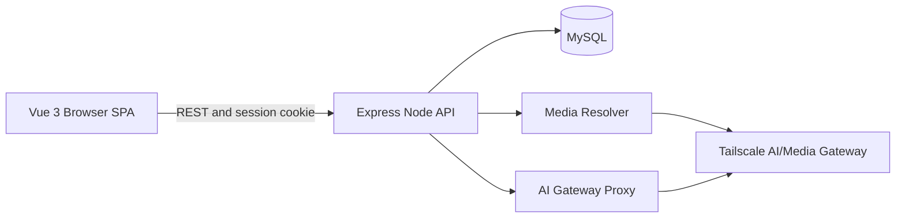

# WorkoutAtlas System Architecture

**Status:** repository-verified; live infrastructure status may require separate environment evidence.

## Components

## Frontend

- Vue 3, Vite, Vue Router, Bootstrap, Vue I18n, Pinia where used.
- Route definitions are in `frontend/src/router/routing.js`.
- Domain pages are in `frontend/src/views/Guest`, `frontend/src/views/Member`, and related components.
- API base in development is `http://localhost:5000`, with production fallback to `https://api.workoutatlas.com` according to `frontend/src/config/env.js`.

## Backend

- Node.js and Express 4.
- Route modules are mounted in `backend/server.js`.
- MySQL access uses `mysql2` and pool configuration in `backend/db.js`/`backend/dbConfig.js`.
- Session middleware uses Express sessions and configured session store behavior.
- Media and AI gateway routes are separate backend modules.

## Verified domains

- Authentication and registration: `backend/api/auth.js`
- Users and workout plans: `backend/api/users.js`
- Exercises: `backend/api/excerises.js`
- Workout sessions: `backend/api/workout-sessions.js`
- Workout history: `backend/api/workout-log.js`
- Media: `backend/api/media.js`
- AI gateway: `backend/api/ai-gateway.js`

## Trust boundaries

- Browser requests use credentials/session cookies.
- Backend authorization must remain independent of frontend visibility.
- Media delivery uses backend resolver paths; direct infrastructure bypass is not an approved design.
- Secrets and gateway tokens must remain in environment configuration, not repository docs.
