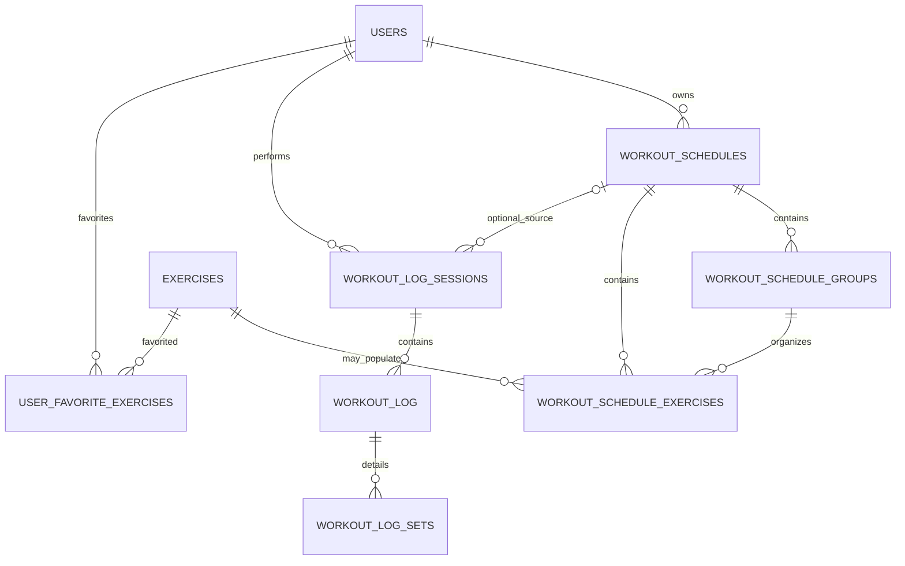

# WorkoutAtlas Database Relationships

## Repository-verified Mermaid relationship view

## Verification status

- Direct foreign keys for schedules/groups/exercises/sessions are declared in `backend/schema/workout_schedule_schema.sql`.
- The exercise favorite relationship is declared in `backend/schema/exercises_schema.sql`.
- Goal relationships are source-backed by the user-goals migration and schedule SQL.
- Live foreign-key metadata, constraint names, and environments are not live-verified for this task.
